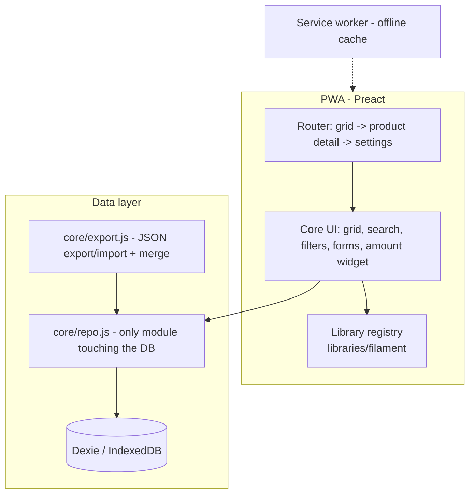
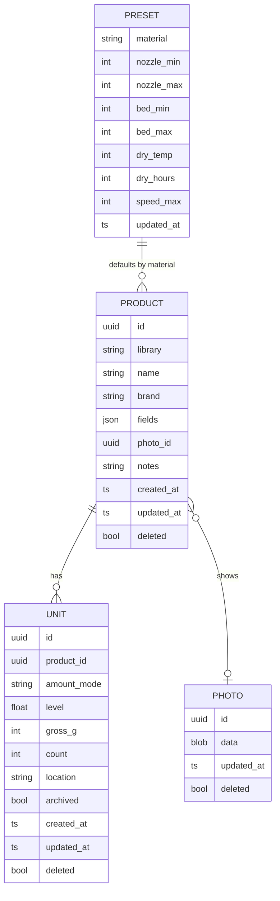
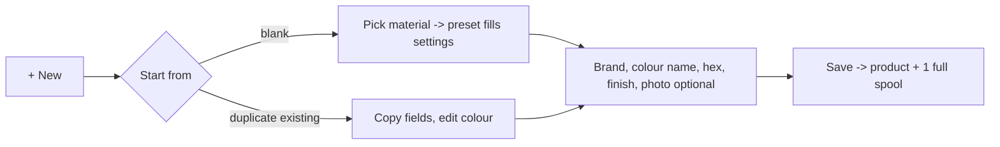
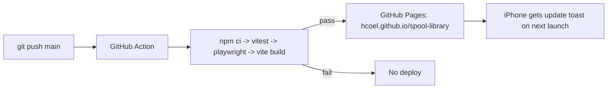

# Spool Library - Design Spec

Date: 2026-10-12
Status: Draft for review

## 1. Purpose

A personal iPhone app to catalogue a 3D printer filament collection: see each filament's colour at a glance, its brand/type/print settings, and roughly how much is left. Built so further libraries (electronics: microcontrollers, sensors) can be added later with minimal rework.

### Goals

- Custom fit, minimal upkeep (no server to run, no app store signing).
- Fast data entry (duplicate an existing product, presets fill print settings).
- Data never lost silently (backup export, reminders, persistent storage).

### Non-goals (v1)

- Printer integration (Bambu X2D MQTT needs an always-on bridge; Safari has no raw MQTT).
- NFC/RFID scanning (Safari has no Web NFC).
- Multi-device sync (data model is sync-ready; feature deferred).
- In-app library builder (new libraries are added as code files).
- Electronics library (phase 2).

## 2. Platform and stack

| Concern | Choice | Why |
|---|---|---|
| Delivery | PWA, installed to iPhone home screen | No 7-day re-signing or $99/yr Apple account; offline capable |
| UI | Preact + JSX | React-style components, ~10 KB |
| Build | Vite + `vite-plugin-pwa` | Generates service worker / manifest |
| Storage | Dexie over IndexedDB | Simple API, versioned migrations, sync path later |
| Tests | Vitest (+ `fake-indexeddb`), Playwright (WebKit) | Unit/data layer + Safari-engine smoke test |
| Hosting | GitHub Pages, public repo `HCoel/spool-library` | Free; code is public, data never leaves the phone |
| CI/CD | GitHub Actions: test, build, deploy on push to `main` | Failing tests block deploys |

## 3. Architecture



Rules:

- UI components never import Dexie. All reads/writes go through `core/repo.js`. Sync later changes only this layer.
- Core code is library-agnostic. Library-specific fields, presets and widgets live in `libraries/<name>/`.
- The bottom tab bar is generated from the library registry.

### Folder layout

```
src/
  app.jsx
  core/        db.js, repo.js, export.js, amount.js, presets.js, validate.js, color.js
  ui/          Grid.jsx, ProductDetail.jsx, ProductForm.jsx, UnitSheet.jsx,
               AmountWidget.jsx, Search.jsx, Filters.jsx, Settings.jsx,
               InstallGate.jsx, ErrorBoundary.jsx, Toast.jsx
  libraries/
    index.js   registry
    filament/  index.js (field defs, presets, unit label), Swatch.jsx
tests/
  unit/        vitest
  e2e/         playwright
```

### Library definition contract

Each library exports:

| Key | Purpose | Filament value |
|---|---|---|
| `id` | Stored on products | `"filament"` |
| `label` | Tab name | `"Filament"` |
| `unit_label` | Name for a unit | `"Spool"` |
| `amount_mode` | Default unit amount mode | `"level"` (weight optional) |
| `fields` | Field definitions (key, type, required, validation) | see 4.2 |
| `presets` | Default settings keyed by a field (material) | see 4.3 |
| `Visual` | Component drawing the product's tile image | `Swatch` |
| `summary(product, units)` | Tile subtitle | e.g. `"x3 - 1.4 kg"` |
| `facets` | Filter chips | material, finish, colour family |

## 4. Data model



### 4.1 Common rules

- IDs are UUID v4 (`crypto.randomUUID()`).
- Every write sets `updated_at` (ISO string, UTC).
- Deletes are tombstones (`deleted: true`). Queries exclude tombstones. Tombstones are kept (needed for future sync and import merge).
- A product with zero non-deleted units is valid (e.g. all used up and hard-deleted by mistake); it shows "0 spools".

### 4.2 Filament product `fields`

| Key | Type | Required | Default / rule |
|---|---|---|---|
| `material` | enum: PLA, PETG, ABS, ASA, TPU, Nylon, PLA Support, PLA/PETG Support, Other | yes | - |
| `color_name` | string | no | e.g. "Jade White" |
| `color_hex` | `#RRGGBB` | yes | colour picker or text |
| `color_hex_2`, `color_hex_3` | `#RRGGBB` | no | used when finish = multi |
| `finish` | enum: basic, matte, silk, sparkle, translucent, multi, glow, wood | yes | `basic` |
| `diameter` | number (mm) | yes | 1.75 |
| `net_g` | int | yes | 1000 |
| `empty_spool_g` | int | yes | 250 |
| `overrides` | object of print settings | no | only keys differing from the preset |

`name` (product level) is required; defaults to `"{brand} {material} {color_name}"` when left blank.

### 4.3 Print settings and presets

Settings keys: `nozzle_min`, `nozzle_max`, `bed_min`, `bed_max`, `dry_temp`, `dry_hours`, `speed_max` (mm/s, optional, may be null). Datasheets quote speed as "< N mm/s", so it is stored as a maximum. Drying uses the oven / dryer value (not the printer-heatbed alternative).

Effective settings = `{...preset[material], ...overrides}`. The detail view marks overridden values with a star.

Seeded presets (user-editable in Settings):

| Material | Nozzle (C) | Bed (C) | Dry | Max speed | Source |
|---|---|---|---|---|---|
| PLA | 190-230 | 55-60 | 55 C / 8 h | null | generic |
| PETG | 230-260 | 70-80 | 65 C / 8 h | null | generic |
| ABS | 240-270 | 90-100 | 80 C / 8 h | null | generic |
| ASA | 240-270 | 90-100 | 80 C / 8 h | null | generic |
| TPU | 210-240 | 30-35 | 70 C / 8 h | null | generic |
| Nylon | 260-290 | 80-100 | 80 C / 12 h | null | generic |
| PLA Support | 220-230 | 35-45 | 55 C / 8 h | 200 | Bambu Support for PLA TDS v1.0 |
| PLA/PETG Support | 190-240 | 35-60 | 75 C / 8 h | 100 | Bambu Support for PLA/PETG TDS |
| Other | null | null | null | null | - |

Generic rows are starting points; edit them in Settings to match the brands you use. Both Bambu support filaments ship on 0.5 kg spools, so `net_g` must be set per product (default 1000 is wrong for these).

### 4.4 Units (spools) and amount

- `amount_mode`: `level` | `weight` | `count` (count reserved for electronics).
- Level mode: `level` is one of 1, 0.75, 0.5, 0.25, 0.1 (Low), 0 (Empty).
- Weight mode: user enters `gross_g` (scale reading). `remaining_g = clamp(gross_g - empty_spool_g, 0, net_g)`. `level` is derived as `remaining_g / net_g`.
- Switching from weight to level discards `gross_g`; switching level to weight requires a reading.
- Displayed remaining in level mode: `round(level * net_g)` prefixed with `~`.
- Product total remaining = sum over non-archived, non-deleted units.
- New product creates one unit at level 1 (Full).
- `archived: true` hides the unit unless "Show archived" is on.

## 5. Screens and flows

### 5.1 Screens

```
GRID (home)                    PRODUCT DETAIL
+--------------------+         +--------------------+
| Filament    (gear)+|         | < Bambu PLA Basic  |
| search...          |         |   [swatch] Black   |
| [PLA][PETG][Silk]..|         |            Matte   |
| [tile][tile][tile] |         | PLA - 1.75 - 1kg   |
| [tile][tile][tile] |         | Nozzle 190-230 C   |
|                    |         | Bed    55-60 C     |
| [Filament]         |         | Dry    55 C 8h *   |
+--------------------+         | -- Spools (3) ---- |
                               | #1 ######-- ~600g  |
UNIT SHEET                     | #2 ######## Full   |
+--------------------+         | [+ Add spool]      |
| Spool #1           |         | Show archived (2)  |
| [Full 3/4 1/2 1/4 Low]       | [Edit] [Duplicate] |
| Weight: [812] g    |         +--------------------+
| -> ~600 g left     |
| Location: [Box A]  |         SETTINGS
| [Archive] [Delete] |         Material presets >
+--------------------+         Export backup / Import backup
                               Last backup: 12 days ago (!)
```

- Tile: swatch (always, since hex is required), material, colour name, unit count, total remaining.
- Search: case-insensitive substring over name, brand, color_name, notes.
- Filters (chips, AND across groups, OR within a group): material, finish, colour family, show archived.
- Colour family derived from hex via HSL: saturation < 15% or lightness < 12% / > 92% = neutral; otherwise hue buckets red (345-15), orange (15-45), yellow (45-70), green (70-170), blue (170-260), purple (260-345).
- Sort: name (default), remaining (low first), recently updated.
- Products whose units are all archived sort to the bottom.

### 5.2 Swatch rendering (SVG)

| Finish | Rendering |
|---|---|
| basic | Flat fill + soft top highlight |
| matte | Flat fill |
| silk | Diagonal linear gradient with a bright sheen band |
| sparkle | Base fill + white specks, positions seeded from product id |
| translucent | Fill at 60% opacity over a checkerboard |
| multi | Pie split of `color_hex`, `color_hex_2`, `color_hex_3` (2 or 3 slices) |
| glow | Fill + outer glow ring |
| wood | Fill + subtle darker grain stripes |

The detail view shows the photo (if any) next to the swatch.

### 5.3 Flows



- Duplicate copies product fields and overrides, not units or photo.
- Update amount: tap unit -> tap level or enter weight (auto-saves).
- Delete (product or unit) requires a confirm dialog; archive is the normal path.
- Photo: `<input type="file" accept="image/*">` (camera or library). Resized client-side to max 1200 px long edge, JPEG quality 0.8, stored as a blob.

## 6. iOS behaviour and error handling

### 6.1 iOS risks

| Risk | Mitigation |
|---|---|
| Safari tab and home-screen app have separate storage | `InstallGate`: when not running standalone (`navigator.standalone !== true` and not `display-mode: standalone`), show Add to Home Screen instructions; a "use in browser anyway" link dismisses it for the session |
| Storage eviction | Call `navigator.storage.persist()` on start; home-screen apps are exempt from the 7-day rule; backup reminder |
| Removing the app deletes data | Settings explains this next to Export |
| HEIC photos | Decoded via canvas in Safari during resize, re-encoded to JPEG |

### 6.2 Updates

- `vite-plugin-pwa` in `prompt` mode: when a new service worker is waiting, show a toast "Update available - Reload". Never auto-reload.
- Schema changes use Dexie `version(n).stores(...).upgrade(...)`. Every migration has a test.

### 6.3 Validation

| Input | Rule |
|---|---|
| hex | `/^#[0-9a-fA-F]{6}$/` |
| nozzle | 150-350, min <= max |
| bed_min, bed_max | 0-120, min <= max |
| dry_temp | 30-100; dry_hours 1-48 |
| gross_g | >= 0; below `empty_spool_g` warns "check empty spool weight" and saves remaining as 0 |
| net_g, empty_spool_g | 1-5000 |
| required | material, color_hex, finish (name auto-derived) |

Invalid fields show inline messages; save is disabled until valid.

### 6.4 Backup: export / import

- Export: JSON `{ format_version: 1, exported_at, products, units, presets, photos }` with photos as base64. Delivered via `navigator.share` with a File when available (iOS share sheet -> Save to Files / iCloud Drive), falling back to a download link. Records `last_backup_at` in a settings table.
- Backup reminder: Settings shows days since last backup; badge on the gear icon when >= 14 days or never (and at least one product exists).
- Import:
  1. Parse and validate `format_version` and shape; reject with a clear message otherwise.
  2. Preview counts: new / updated / unchanged (per table).
  3. Merge by `id`: incoming record wins only if its `updated_at` is newer. Tombstones apply like any other record.
  4. Apply in a single Dexie transaction (all or nothing).

### 6.5 Runtime errors

- `repo.js` calls are awaited in UI handlers with try/catch -> toast "Couldn't save - try again"; form state is kept.
- Top-level `ErrorBoundary` shows an error screen with an Export backup button.

## 7. Testing

| Layer | Tool | Covers |
|---|---|---|
| Core logic | Vitest | amount maths (clamp, level derivation, totals), preset+override merge, colour family buckets, validation rules |
| Data | Vitest + fake-indexeddb | repo CRUD, tombstones, archive filtering, export->import round-trip equality, merge (newer wins, older ignored, tombstones), migrations |
| UI smoke | Playwright (WebKit) | add product -> add spool -> set weight -> archive -> filter hides/shows -> export triggers download |
| Device | Manual checklist (README) | install to home screen, airplane mode, camera photo, export to iCloud Drive, update toast |

Core and data layers are built test-first.

## 8. Deployment



- Vite `base: '/spool-library/'`; manifest `start_url` and `scope` match.
- App icons (192, 512, apple-touch-icon 180) generated from a simple SVG.

## 9. Phase 1 acceptance criteria

1. Installable on iPhone from the Pages URL; launches standalone and works in airplane mode.
2. Add, edit, duplicate, delete filament products with SVG swatch and optional photo.
3. Editable material presets; per-product overrides shown with a marker.
4. Spools: add, level or weight, location, archive/unarchive, delete.
5. Search, filters (material, finish, colour family, archived) and sort work together.
6. Export and import (with preview and merge); backup reminder after 14 days.
7. All Vitest and Playwright tests pass in CI; deploy blocked on failure.

## 10. Phase 2 (outline only)

Electronics library: `libraries/electronics/` with `amount_mode: "count"`, fields such as category (MCU, sensor, display, power), interface (I2C, SPI, UART, GPIO), voltage, datasheet URL, and a photo-based `Visual`. No core changes expected beyond any gaps found then.
